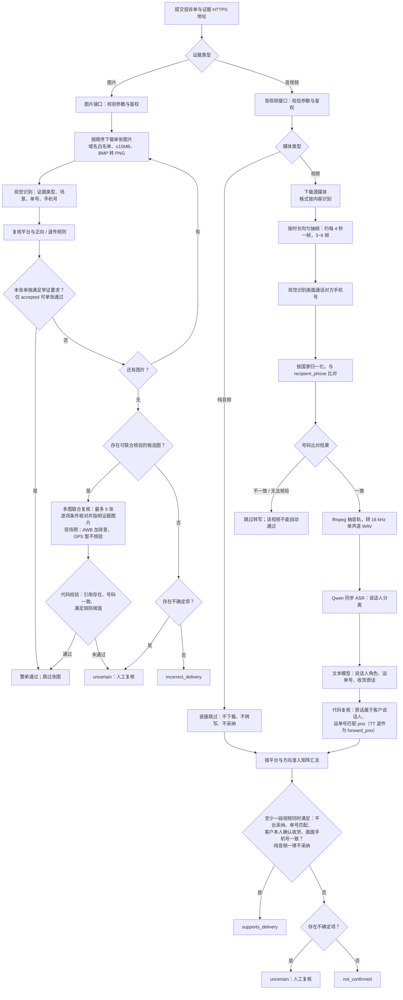
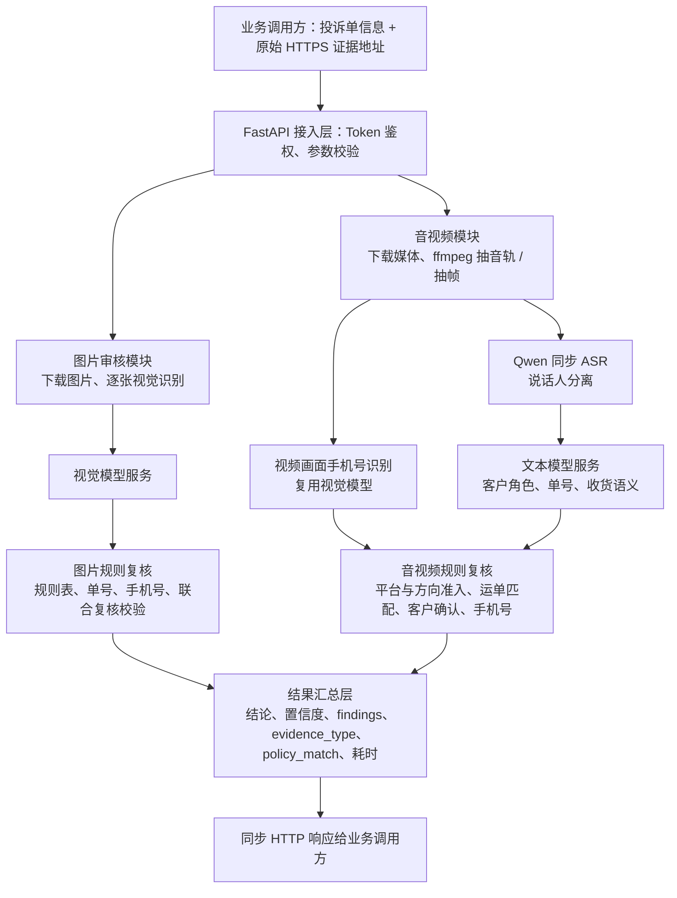

# 妥投信息审核：流程与架构

> 分享说明：系统审核的是“提交的证据是否足以支持本单妥投”，不会仅凭某个关键词或图片里出现包裹就自动判定。平台、业务方向、运单关联和客户身份等必要条件缺失或无法核验时，结果进入人工复核。

举证规则以飞书《DNR举证要求》（1.5）为准，按平台（TT、SHOPEE、LAZADA、SHEIN、TMALL）和方向（正向 `forward` / 退件 `return`）区分。LAZADA 与其他平台一样，只按对应方向的要求判断，不区分新旧版本。当前只处理泰国（TH）规则。

## 审核流程图

## 系统架构图

## 分享时强调的判定原则

- **图片**：逐张单独送审；只有一张图片本身满足对应举证要求（`accepted`），整单才提前通过。`conditional`（需要多项条件或多张图配合）永远不能单张通过，逐张审核结束后自动做多图联合复核，由代码校验条件和证据来源。包裹特写、无法确认拍摄场景或无法关联到本单的图片，不能只因“看起来像包裹”而判妥投。
- **正向现场照（原合格 EPOD 包裹照片）**：LAZADA 为 AWB、背景、收件人 1 公里内 GPS 三项满足两项；SHOPEE（已确认认可）、SHEIN、TMALL 规则相同但不看 GPS，即 AWB 与背景两项都要满足。AWB 指图片内包裹上的运单号与目标 `pno` 完整一致，多张图中任一张能判定一致即可；背景指能体现收件人最终交付地点（门牌号、居住环境等）。GPS 是否在 1 公里内将由业务方后续通过请求参数提供，目前一律不判定：结果里 `gps_within_1km` 固定为未满足并标注“待参数核验”，所以 LAZADA 现阶段也需要 AWB 与背景同时满足。收件人姓名暂不核对。
- **EPOD 图片与补派照**：1.5 第 3、4 行（原合格 EPOD 包裹照片、DNR 投诉后再次派送的合格包裹照片）看的是系统里的 EPOD 图片，不是用户上传的图片。请求里用图片级的 `is_epod=true` 标记 EPOD 图片，并传 `dnr_created_at`（DNR 创建时间，未带时区按泰国时间 UTC+7）。对 EPOD 图片，模型只抄录水印上的拍照时间，由代码比较：**拍照时间晚于 `dnr_created_at` 判为补派照，否则判为原合格 EPOD**。没有水印、时间无法解析、没传 `dnr_created_at`、或水印只有日期且与 DNR 创建日同一天，都按原合格 EPOD 处理，并在 findings 里写明原因。`is_epod` 不是 true 的图片，不适用原合格 EPOD、补派照这两类规则，统一按 `unsupported`，不能通过。
- **代码裁决，不采信模型自述（图片）**：证据类型在平台/方向下是否被采纳，由代码按 1.5 准入矩阵校正 `policy_match`（模型标错会被改正并在 findings 留痕）；运单号和手机号是否一致，由代码拿模型抄录的图片原文去和目标单号、`recipient_phone` 比对（手机号按国家码归一化），单张通过和联合复核的 AWB、手机号核对都以此为准。退件按证据类型取目标号：TT 退件的短信、WhatsApp 只认 `forward_pno`，其余都与 `pno` 完整一致。
- **图片接口不走录音/视频规则**：客服回访录音、快递员电话视频、电话音频的原件是媒体文件，「客户回复已收到」只能由音视频接口核验。图片里即使是这三类的截图，所有平台、正向和退件一律 `policy_match=unsupported`，不能单张通过，也不参与联合复核，结果为 `uncertain`；截图上可见的单号、手机号仍会如实记录。
- **客户确认类图片**：提取并记录图片中实际可读的运单号、手机号及比对状态。`recipient_phone` 是调用方传入的本单收件手机号；号码无法辨认或不一致时，不作为身份确认依据。泰国号码按国家码规则归一化后比较。
- **录音/录屏**：先得到带说话人和时间信息的转写，再判断“收到”是否由客户本人表达；客服说出收货话术、单纯出现关键词都不够。还要核对目标运单号和平台证据准入规则。
- **视频手机号**：视频先核验画面里的通话对方手机号。以完整可读的通话对方号码为准；转场或遮挡造成的不可读帧，只要可见数字与完整号码不矛盾就忽略，出现多个不同完整号码则无法核验。号码不一致或无法核验时跳过转写，不能自动通过。纯音频没有画面，无法核验「询问客户电话号码一致」，业务确认所有平台、两个方向的纯音频一律不采纳（`policy_match=rejected`），不下载、不转写、不调用模型，结果里只写明跳过原因。
- **平台与方向**：图片和音视频都使用 `platform`（大小写不敏感）和 `direction` 匹配正向/退件规则；缺失 `platform` 或 `direction` 时返回 `uncertain`。Buyer return 的数据由业务方在调用前过滤，不会推送到本接口。
- **正向单号**：图片和音视频接口都可传可选参数 `forward_pno`，仅 TT 退件使用。1.5 只有 TT 退件要求按正向单号沟通：TT 退件的短信、WhatsApp、电话视频、客服回访只认 `forward_pno`，没传时返回 `uncertain`；其余平台和方向都是「单号跟反馈单号一致」，即与 `pno` 完整一致，不使用 `forward_pno`。
- **证据类型对齐**：音视频每个文件结果也带 `evidence_type`（`courier_call_video` / `courier_call_audio`）和 `policy_match`（`accepted` / `rejected` / `conditional` / `unknown`，由代码按准入矩阵给出），与图片结果字段一致。
- **失败降级**：关键字段缺失、证据冲突或模型、媒体处理失败时返回 `uncertain`，不猜测通过。
- **当前音视频边界**：服务接收原始 HTTPS 媒体地址；在服务端抽音轨后调用 Qwen 同步 ASR。当前默认限制媒体 5 分钟、源文件和抽取音频各 24 MiB，每单总时限默认 900 秒，可通过部署配置调整；上述大小和时长上限为当前代码限制。

## 接口入口

| 证据 | 接口 | 主要输入 |
| --- | --- | --- |
| 图片、聊天截图、签收/投递照片 | `POST /v1/delivery-image/reviews` | `request_id`、`pno`、`country`、`platform`、`direction`、`forward_pno`（可选）、`images`（每张可带 `is_epod`）、`dnr_created_at`（可选，EPOD 补派判定用），客户确认类核验使用 `recipient_phone` |
| 通话录音、录屏 | `POST /v1/delivery-conversation/reviews` | `request_id`、`pno`、`country`、`platform`、`direction`、`forward_pno`（可选）、`media_files`，视频核验使用 `recipient_phone` |

图片审核与音视频审核共用服务 Token 鉴权、`platform`、`direction` 和 `forward_pno` 参数；两条链路分别处理媒体，最后返回结构化审核结果，供业务侧记录和人工复核。音视频请求会逐段处理后汇总，图片请求则支持单张通过后提前停止。服务对业务调用方是同步响应，音视频整单总时限默认 900 秒，调用方超时需配置得更长。

## 视频手机号核验

从视频中按时长均匀抽取关键帧（约每 4 秒一帧，至少 3 帧、至多 6 帧，首尾必取），一次送视觉模型识别画面中实际拨打或通话对方的手机号，再由代码与调用方传入的本单收件手机号 `recipient_phone` 比对。模型看不到目标号码，比对完全在代码里完成。应区分通话对方号码与本机号码、通讯录其他号码；仅有联系人昵称不能认定号码一致。

例如泰国号码 `0991812244` 与 `+66 99-181-2244` 归一化后视为一致。结果保留画面中识别的号码原文、匹配状态和帧时间点；号码遮挡、模糊、缺失或不能确认号码用途时，标记无法核验，不补全猜测。

视频通过条件是在平台采纳、目标运单匹配和客户本人明确收货确认之外，再满足画面通话手机号与 `recipient_phone` 一致；号码不一致或无法核验时不能自动通过。缺少 `recipient_phone` 的视频无法核对身份，也不能自动通过。

## 与 1.5 文档字面不一致的有意处理

以下均为业务已确认的处理，文档表格本身没有同步，对照代码时请以本节为准：

| 项 | 1.5 表里写的 | 当前处理 |
| --- | --- | --- |
| SHOPEE 正向现场照 | ✅ 后标注「改为❌，待与 PMD 确认」 | 业务确认认可：AWB 加背景，不看 GPS |
| SHEIN、TMALL 正向现场照 | ✅，未写条件 | 同 LAZADA，但不看 GPS：AWB 加背景 |
| LAZADA 正向现场照 | AWB、背景、GPS 三项满足两项 | GPS 暂不判定（待业务方提供参数），实际需要 AWB 加背景 |
| 纯音频 | 多数平台 ✅ | 所有平台、方向一律不采纳，不下载、不转写 |
| 图片接口里的客服回访录音、电话视频、电话音频 | 多数平台 ✅ | 图片接口不走录音/视频规则，一律 `unsupported`，需走音视频接口 |
| LINE/微信的收件人名称 | 需要核对 | 暂不核对 |
| 补派照、退件签收照的运单号 | 未写单号要求 | 单张通过时要求图里读到完整 `pno` |
| 补派照的识别 | 未写如何识别 | 仅系统 EPOD 图片（`is_epod`），按水印拍照时间是否晚于 `dnr_created_at` 判定 |
| LAZADA 短信改地址例外 | 可用短信证明客户要求改地址 | 只能证明改址，不能证明妥投，LAZADA 正向短信仍按拒绝处理 |

