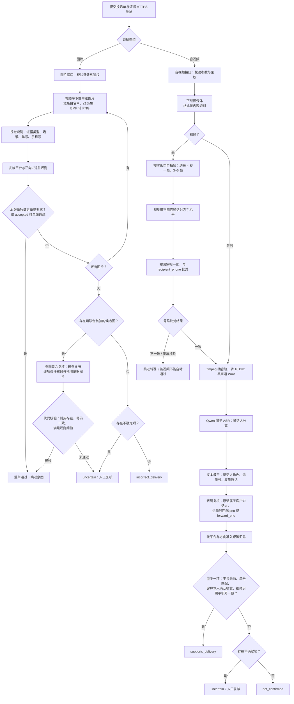
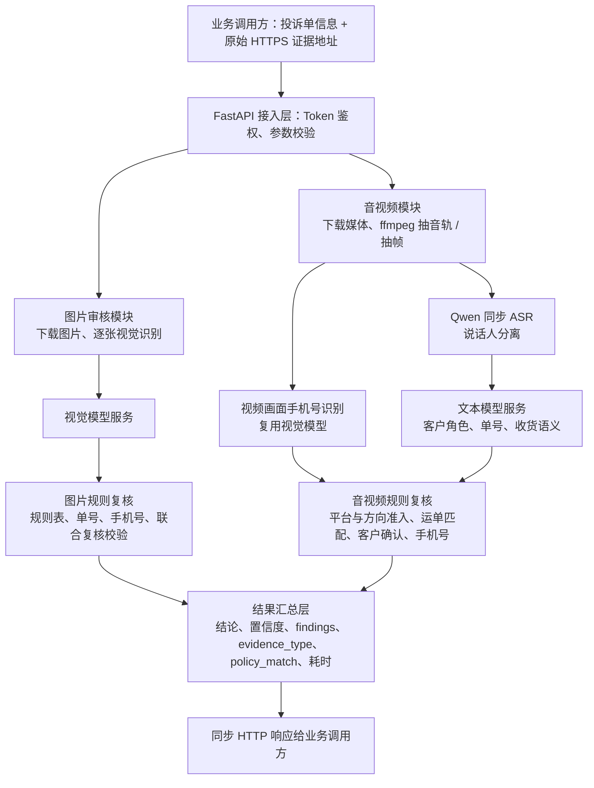

# 妥投信息审核：流程与架构

> 分享说明：系统审核的是“提交的证据是否足以支持本单妥投”，不会仅凭某个关键词或图片里出现包裹就自动判定。平台、业务方向、运单关联和客户身份等必要条件缺失或无法核验时，结果进入人工复核。

举证规则以飞书《DNR举证要求》（1.5）为准，按平台（TT、SHOPEE、LAZADA、SHEIN、TMALL）和方向（正向 `forward` / 退件 `return`）区分。正向的 LAZADA 执行 0910 新规则；退件的 LAZADA 沿用原规则。

## 审核流程图

## 系统架构图

## 分享时强调的判定原则

- **图片**：逐张单独送审；只有一张图片本身满足对应举证要求（`accepted`），整单才提前通过。`conditional`（需要多项条件或多张图配合）永远不能单张通过，逐张审核结束后自动做多图联合复核，由代码校验条件和证据来源。包裹特写、无法确认拍摄场景或无法关联到本单的图片，不能只因“看起来像包裹”而判妥投。
- **客户确认类图片**：提取并记录图片中实际可读的运单号、手机号及比对状态。`recipient_phone` 是调用方传入的本单收件手机号；号码无法辨认或不一致时，不作为身份确认依据。泰国号码按国家码规则归一化后比较。
- **录音/录屏**：先得到带说话人和时间信息的转写，再判断“收到”是否由客户本人表达；客服说出收货话术、单纯出现关键词都不够。还要核对目标运单号和平台证据准入规则。
- **视频手机号**：视频先核验画面里的通话对方手机号。以完整可读的通话对方号码为准；转场或遮挡造成的不可读帧，只要可见数字与完整号码不矛盾就忽略，出现多个不同完整号码则无法核验。号码不一致或无法核验时跳过转写，不能自动通过。纯音频没有画面，不做手机号核验，也不能声称手机号已核验。
- **平台与方向**：图片和音视频都使用 `platform`（大小写不敏感）和 `direction` 匹配正向/退件规则；缺失 `platform` 或 `direction` 时返回 `uncertain`。
- **正向单号**：退件单与客户沟通时可能使用正向运单号，图片和音视频接口都可传可选参数 `forward_pno`。退件方向下，通话或截图里的运单号与 `pno` 或 `forward_pno` 任一完整一致即视为运单一致；TT 退件必须按正向单号沟通，只认 `forward_pno`，没传时返回 `uncertain`。正向方向不使用 `forward_pno`。
- **证据类型对齐**：音视频每个文件结果也带 `evidence_type`（`courier_call_video` / `courier_call_audio`）和 `policy_match`（`accepted` / `rejected` / `conditional` / `unknown`，由代码按准入矩阵给出），与图片结果字段一致。
- **失败降级**：关键字段缺失、证据冲突或模型、媒体处理失败时返回 `uncertain`，不猜测通过。
- **当前音视频边界**：服务接收原始 HTTPS 媒体地址；在服务端抽音轨后调用 Qwen 同步 ASR。当前默认限制媒体 5 分钟、源文件和抽取音频各 24 MiB，每单总时限默认 900 秒，可通过部署配置调整；上述大小和时长上限为当前代码限制。

## 接口入口

| 证据 | 接口 | 主要输入 |
| --- | --- | --- |
| 图片、聊天截图、签收/投递照片 | `POST /v1/delivery-image/reviews` | `request_id`、`pno`、`country`、`platform`、`direction`、`forward_pno`（可选）、`images`，客户确认类核验使用 `recipient_phone` |
| 通话录音、录屏 | `POST /v1/delivery-conversation/reviews` | `request_id`、`pno`、`country`、`platform`、`direction`、`forward_pno`（可选）、`media_files`，视频核验使用 `recipient_phone` |

图片审核与音视频审核共用服务 Token 鉴权、`platform`、`direction` 和 `forward_pno` 参数；两条链路分别处理媒体，最后返回结构化审核结果，供业务侧记录和人工复核。音视频请求会逐段处理后汇总，图片请求则支持单张通过后提前停止。服务对业务调用方是同步响应，音视频整单总时限默认 900 秒，调用方超时需配置得更长。

## 视频手机号核验

从视频中按时长均匀抽取关键帧（约每 4 秒一帧，至少 3 帧、至多 6 帧，首尾必取），一次送视觉模型识别画面中实际拨打或通话对方的手机号，再由代码与调用方传入的本单收件手机号 `recipient_phone` 比对。模型看不到目标号码，比对完全在代码里完成。应区分通话对方号码与本机号码、通讯录其他号码；仅有联系人昵称不能认定号码一致。

例如泰国号码 `0991812244` 与 `+66 99-181-2244` 归一化后视为一致。结果保留画面中识别的号码原文、匹配状态和帧时间点；号码遮挡、模糊、缺失或不能确认号码用途时，标记无法核验，不补全猜测。

视频通过条件是在平台采纳、目标运单匹配和客户本人明确收货确认之外，再满足画面通话手机号与 `recipient_phone` 一致；号码不一致或无法核验时不能自动通过。缺少 `recipient_phone` 的视频无法核对身份，也不能自动通过。
